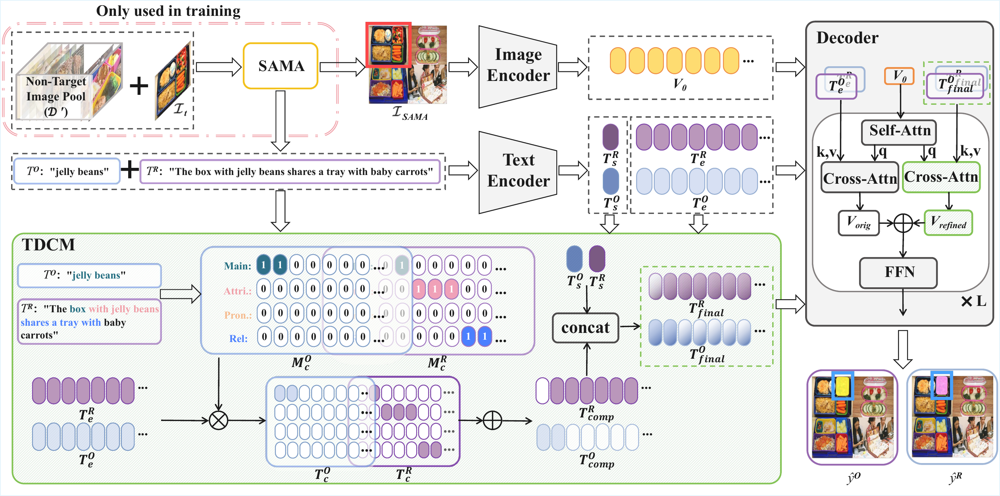

<div align="center">

# Rethinking Language Bias in Referring Image Segmentation via Linguistically Enriched Data Reconstruction and Semantic Alignment

**Lu Zhang, Xiaoyu Guo, Yunzhi Zhuge, Wenbo Zhang, Ping Hu, Huchuan Lu, and You He**

[](https://doi.org/10.1109/TIP.2026.3748959)
[](https://doi.org/10.1109/TIP.2026.3748959)
[](https://www.python.org/)
[](https://pytorch.org/)
[](https://github.com/xiaoyuo-o/Linguistically-Enriched-Referring-Image-Segmentation/releases)
[](LICENSE)

Official PyTorch implementation of our paper published in **IEEE Transactions on Image Processing**.

</div>

<p align="center">
  
</p>

## Introduction

Referring image segmentation (RIS) aims to segment an object specified by a natural-language expression. Existing RIS datasets contain many short and linguistically simple descriptions, which can encourage models to rely on superficial language cues. We rethink this language bias from both the **data** and **model** perspectives.

We reconstruct the original expressions into linguistically enriched descriptions while preserving their target correspondence. We further introduce **SAMA**, a semantic-aware mosaic augmentation strategy, and **DTVI**, a component-aware text-visual interaction module for modeling entities, attributes, pronouns, and relations.

## Highlights

- Reconstructed expression annotations for **RefCOCO**, **RefCOCO+**, and **RefCOCOg**;
- CRIS integration of the proposed **SAMA** and **DTVI** modules;
- Paired training with original and reconstructed expressions using shared parameters;
- Single-branch evaluation and single-image inference;
- Scripts for dataset conversion and CLIP candidate-pool generation.

## Release Scope

This repository provides the **CRIS-based implementation** used in our experiments. The paper also evaluates the proposed design on LAVT and DETRIS, but those implementations are not included in this release.

The code is based on the official [CRIS repository](https://github.com/DerrickWang005/CRIS.pytorch). Please retain [THIRD_PARTY_NOTICES.md](THIRD_PARTY_NOTICES.md) when redistributing the code.

## Installation

The experiments use Python 3.8 and a CUDA-enabled PyTorch environment.

Install PyTorch and torchvision versions compatible with the CUDA driver first, then install the remaining dependencies:

```bash
conda create -n dreris python=3.8 -y
conda activate dreris

# Install the matching CUDA build of PyTorch from https://pytorch.org
pip install torch torchvision
pip install -r requirements.txt

python -m spacy download en_core_web_sm
python -m nltk.downloader wordnet omw-1.4
```

Run all commands from the repository root. If NLTK resources are stored in a custom directory, set `NLTK_DATA` before running.

## Data Preparation

### 1. Download the official datasets

Download the COCO 2014 training images and the official RefCOCO, RefCOCO+, and RefCOCOg annotations from the [REFER repository](https://github.com/lichengunc/refer):

```text
data/refer/
├── images/train2014/
├── refcoco/
│   ├── instances.json
│   └── refs(unc).p
├── refcoco+/
│   ├── instances.json
│   └── refs(unc).p
└── refcocog/
    ├── instances.json
    └── refs(umd).p
```

### 2. Download the reconstructed expressions

Download the three reconstructed-expression archives from the [GitHub Releases page](https://github.com/xiaoyuo-o/Linguistically-Enriched-Referring-Image-Segmentation/releases). Extract and place them at:

```text
data/refer/refcoco/refs(unc_en).p
data/refer/refcoco+/refs(unc_en).p
data/refer/refcocog/refs(umd_en).p
```

These files contain enriched expressions for the same targets as the official annotations. Images and `instances.json` are therefore not redistributed.

### 3. Generate JSON annotations and masks

`tools/data_process.py` supports official (`raw`) and reconstructed (`en`) expressions. For RefCOCO, run:

```bash
python tools/data_process.py \
  --data_root data/refer \
  --output_dir data/refcoco \
  --dataset refcoco \
  --split unc \
  --expression_type raw \
  --generate_mask

python tools/data_process.py \
  --data_root data/refer \
  --output_dir data/refcoco \
  --dataset refcoco \
  --split unc \
  --expression_type en \
  --generate_mask
```

Use `--dataset refcoco+ --split unc` for RefCOCO+ and `--dataset refcocog --split umd` for RefCOCOg.

### 4. Convert the generated files to LMDB

The following commands generate the RefCOCO training and validation LMDBs:

```bash
mkdir -p data/refcoco/raw data/refcoco/enhanced

for SPLIT in train val; do
  python tools/folder2lmdb.py \
    -j data/refcoco/anns/refcoco/${SPLIT}.json \
    -i data/refer/images/train2014 \
    -m data/refcoco/masks/refcoco \
    -o data/refcoco/raw

  python tools/folder2lmdb.py \
    -j data/refcoco/anns/refcoco_en/${SPLIT}.json \
    -i data/refer/images/train2014 \
    -m data/refcoco/masks/refcoco_en \
    -o data/refcoco/enhanced
done
```

Raw and reconstructed records must preserve the same target ordering and `segment_id` correspondence.

### 5. Generate the SAMA candidate pools

SAMA reads two CLIP text-to-image candidate databases during training. Generate them locally with:

```bash
python tools/build_t2i_similarity.py \
  --data-root data/refer \
  --image-dir data/refer/images/train2014 \
  --dataset refcoco \
  --split-by unc \
  --expression-type raw \
  --output data/refcoco/similarity/t2i_similarity.lmdb

python tools/build_t2i_similarity.py \
  --data-root data/refer \
  --image-dir data/refer/images/train2014 \
  --dataset refcoco \
  --split-by unc \
  --expression-type en \
  --output data/refcoco/similarity/t2i_similarity_en.lmdb
```

The script uses OpenAI CLIP ViT-B/32 and stores the top-5000 image candidates for each expression. Candidate databases are generated artifacts and are not included in the source repository.

### Final RefCOCO layout

```text
data/
├── refer/
│   ├── images/train2014/
│   └── refcoco/
│       ├── instances.json
│       ├── refs(unc).p
│       └── refs(unc_en).p
└── refcoco/
    ├── anns/
    ├── masks/
    ├── raw/
    │   ├── train.lmdb/
    │   └── val.lmdb/
    ├── enhanced/
    │   ├── train.lmdb/
    │   └── val.lmdb/
    └── similarity/
        ├── t2i_similarity.lmdb/
        └── t2i_similarity_en.lmdb/
```

## Pretrained Backbone

Training uses the OpenAI CLIP ResNet-101 backbone. Download the original TorchScript weight and place it at:

```text
weights/RN101.pt
```

The trained experiment checkpoint is not included in this source release. For local evaluation, replace the checkpoint path with your own trained checkpoint.

## Training

The public configuration enables the dual-branch CRIS experiment and SAMA:

```bash
cd CRIS_release

CUDA_VISIBLE_DEVICES=0,1,2,3 python train.py \
  --config config/release/refcoco_r101.yaml
```

The configuration uses shared model parameters for the original and reconstructed branches. SAMA uses the two T2I candidate pools and supports the paper's 2x2 mosaic setting. Set `aug.mix_grid: true` in the YAML to enable the optional 3x3 mosaic ablation.

For a smaller run, override existing configuration fields:

```bash
CUDA_VISIBLE_DEVICES=0,1 python train.py \
  --config config/release/refcoco_r101.yaml \
  --opts TRAIN.batch_size 8 TRAIN.batch_size_val 8
```

Training outputs are written below `outputs/refcoco/`.

## Evaluation

Evaluation accepts one checkpoint and evaluates one expression branch at a time. It does not require the SAMA similarity databases.

Original expressions:

```bash
CUDA_VISIBLE_DEVICES=0 python evaluate.py \
  --config config/release/refcoco_r101.yaml \
  --checkpoint path/to/your_checkpoint.pth \
  --branch raw
```

Reconstructed expressions:

```bash
CUDA_VISIBLE_DEVICES=0 python evaluate.py \
  --config config/release/refcoco_r101.yaml \
  --checkpoint path/to/your_checkpoint.pth \
  --branch reconstructed
```

The verified RefCOCO validation results for the local checkpoint are:

| Branch | mIoU | oIoU |
| --- | ---: | ---: |
| Original expressions | 72.45 | 70.25 |
| Reconstructed expressions | 58.95 | 51.54 |

The evaluator also reports precision at IoU thresholds 0.5, 0.6, 0.7, 0.8 and 0.9.

## Single-Image Inference

The demo creates a binary mask and an overlay image. A ground-truth mask is optional; when supplied, the demo also reports IoU.

```bash
CUDA_VISIBLE_DEVICES=0 python demo_infer.py \
  --config config/release/refcoco_r101.yaml \
  --model_ckpt path/to/your_checkpoint.pth \
  --image path/to/image.jpg \
  --sentence "the object described by the expression" \
  --outdir outputs/demo
```

Add `--if_parse` when the input sentence should use the parser-guided component masks.

## Repository Structure

```text
CRIS_release/
├── config/release/refcoco_r101.yaml   # public RefCOCO configuration
├── train.py                            # distributed dual-branch training
├── evaluate.py                         # original/reconstructed evaluation
├── demo_infer.py                       # single-image inference
├── model/                              # CRIS, DTVI decoder and CLIP modules
├── engine/                             # training and validation loops
├── utils/dataset.py                    # paired data loading and SAMA
├── tools/process_caption_parse.py      # text component masks for DTVI
├── weights/                            # CLIP RN101 backbone weight
├── docs/                               # historical upstream CRIS README
├── LICENSE
└── THIRD_PARTY_NOTICES.md
```

## Citation

```bibtex
@article{zhang2026rethinking,
  title={Rethinking Language Bias in Referring Image Segmentation via
         Linguistically Enriched Data Reconstruction and Semantic Alignment},
  author={Zhang, Lu and Guo, Xiaoyu and Zhuge, Yunzhi and Zhang, Wenbo and
          Hu, Ping and Lu, Huchuan and He, You},
  journal={IEEE Transactions on Image Processing},
  year={2026},
  doi={10.1109/TIP.2026.3748959}
}
```

If you use the CRIS implementation, also cite the original CRIS paper and retain the notices in [THIRD_PARTY_NOTICES.md](THIRD_PARTY_NOTICES.md).

## Acknowledgements

We thank the authors of [CRIS](https://github.com/DerrickWang005/CRIS.pytorch) for releasing their code. This repository retains the relevant attribution and licensing information in [THIRD_PARTY_NOTICES.md](THIRD_PARTY_NOTICES.md).

## License

This release is distributed under the MIT License. Third-party components remain subject to their original licenses and notices.
